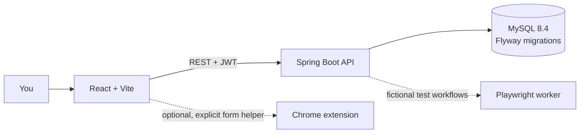

# CareerPilot AI

### Your career search, in one focused workspace.

CareerPilot AI is a full-stack career management app for organizing opportunities and preparing stronger applications. It brings job tracking, resume tools, interview practice, and carefully reviewed application drafts together in one place.

> **Project status:** active B.Tech capstone project. Core flows are implemented and tested locally; hosted authenticated workflows and durable resume storage still need verification. See [Implementation Status](docs/IMPLEMENTATION_STATUS.md) and the [Project Audit](docs/PROJECT_AUDIT.md) for evidence and open work.

**Live links:** [Open CareerPilot](https://career-pilot-ai-blond-seven.vercel.app/) · [Backend readiness](https://careerpilotai-he15.onrender.com/actuator/health/readiness)

---

## What you can do

| Workspace | What it helps with |
| --- | --- |
| **Explore jobs** | Save opportunities, import user-provided roles, and compare role requirements with resume skills. |
| **Resume Studio** | Upload, parse, review, and version resumes; inspect ATS-oriented feedback. |
| **Cover letters** | Create and edit role-specific drafts. Local mode uses a clearly labeled template; an optional AI provider can be configured. |
| **Referral messages** | Prepare separate editable LinkedIn and Instagram referral drafts from a saved job. |
| **Application tracker** | Keep job status and next steps organized. |
| **Interview practice & analytics** | Practice interview questions and review career-search progress. |
| **Auto Apply preparation** | Collect and save application answers, review a final draft, and use the optional Chrome helper for supported form fields. |
| **Automation Center** | Run Playwright workflows against fictional CareerPilot portals and inspect persisted run history. |

### A careful “Auto Apply”

CareerPilot prepares and reviews application information; it does **not** silently submit applications to real employers. The optional Chrome extension can capture visible form structure and fill supported empty text fields after an explicit user action. You still review the employer form, attach the resume yourself, answer unsupported or sensitive questions, and submit it yourself. The Final Apply confirmation records a submission only in CareerPilot’s fictional demo portal.

See [Chrome helper setup and limitations](docs/AUTO_APPLY_BROWSER_AUTOFILL.md) and the [real-site automation boundary](docs/REAL_SITE_AUTOMATION.md).

---

## How it fits together



| Layer | Technology |
| --- | --- |
| Frontend | React, JavaScript, Vite |
| Backend | Java 21, Spring Boot 3.5, Maven Wrapper, Spring Security/JWT, Spring Data JPA |
| Database | MySQL 8.4, Flyway |
| Browser workflows | Playwright; optional Chrome Manifest V3 helper |
| Current hosting | Vercel frontend, Render backend, Aiven MySQL |

---

## Run locally on Windows

Install/use Node.js and npm, Java 21, and MySQL 8.4. Docker is not required for local development. First create/configure the dedicated `careerpilot` MySQL database and credentials; backend startup applies pending Flyway migrations, so point it only at the intended database. The existing root `.env` is not loaded automatically and should remain untouched.

Open two PowerShell windows from the repository root.

**Terminal 1 — backend** (replace the placeholders with your local MySQL credentials):

```powershell
$env:DATABASE_URL =   'jdbc:mysql://localhost:3306/careerpilot?useSSL=false&allowPublicKeyRetrieval=true&connectionTimeZone=UTC'
$env:DATABASE_USERNAME = '<your-local-mysql-user>'
$env:DATABASE_PASSWORD = '<your-local-mysql-password>'
$env:JWT_SECRET = '<private random value of at least 32 bytes>'
$env:FRONTEND_ORIGIN = 'http://localhost:5173'
Set-Location .\backend
.\mvnw.cmd spring-boot:run
```

**Terminal 2 — frontend:**

```powershell
Set-Location .\frontend
npm ci       # first run, or after the lockfile changes
npm run dev -- --host 127.0.0.1
```

Open [http://127.0.0.1:5173](http://127.0.0.1:5173). The API defaults to `http://localhost:8080/api/v1`. Keep both terminals open while using the app. For a repeat visit after dependencies are installed, you can omit `npm ci`.

For optional AI drafting, configure a private `AI_API_KEY` on the backend process and the provider setting described in [AI provider setup](docs/AI_PROVIDER.md). Never put private keys in `VITE_*` variables or commit them.

---

## Checks

From `frontend/`:

```powershell
npm test
npm run build
npm run test:e2e
```

From `backend/`:

```powershell
.\mvnw.cmd -B test
```

The Playwright suite includes fictional-portal simulations. Live E2E checks require the local database, backend, and frontend. Historical passes in the status document describe what was run then; they do not mean services are running now.

---

## Deployment & known limits

The current hosting plan is Vercel (frontend), Render (Spring Boot backend), and Aiven (MySQL). The public links above were previously checked for basic availability, but authenticated workflows and the newest Auto Apply release have not been re-verified live. See [Deployment Guide](docs/DEPLOYMENT.md) before redeploying.

- Render Free may sleep between requests, causing a slow first response.
- Resume details live in MySQL, but uploaded file bytes currently use the backend filesystem. On the free Render filesystem those files may disappear after restart/redeploy; a resume entry can remain while its file is unavailable. Durable private object storage is still needed.
- The Auto Apply application-fields and demo-submission schema includes Flyway V4. It is in the repository; hosted migration/deployment status is not verified. Do not assume the newest flow is live until the backend deploy succeeds and the migration is observed.
- The hosted backend image does not currently provide the Node/Playwright browser worker expected by Automation Center. Local fictional simulations do not prove hosted automation works.
- No real-employer submission integration is implemented. CAPTCHA/MFA and employer security controls are never bypassed.

---

## Project notes

- [Implementation status and test evidence](docs/IMPLEMENTATION_STATUS.md)
- [Full requirements audit](docs/PROJECT_AUDIT.md)
- [Deployment instructions](docs/DEPLOYMENT.md)
- [Database migration progress](docs/MIGRATION_PROGRESS.md)
- [Testing guide](docs/TESTING.md)
- [API documentation](docs/API_DOCUMENTATION.md)
- [AI provider setup](docs/AI_PROVIDER.md)

CareerPilot is a productivity and preparation tool, not an employment guarantee. Verify job postings and all application details before sharing them with an employer.
